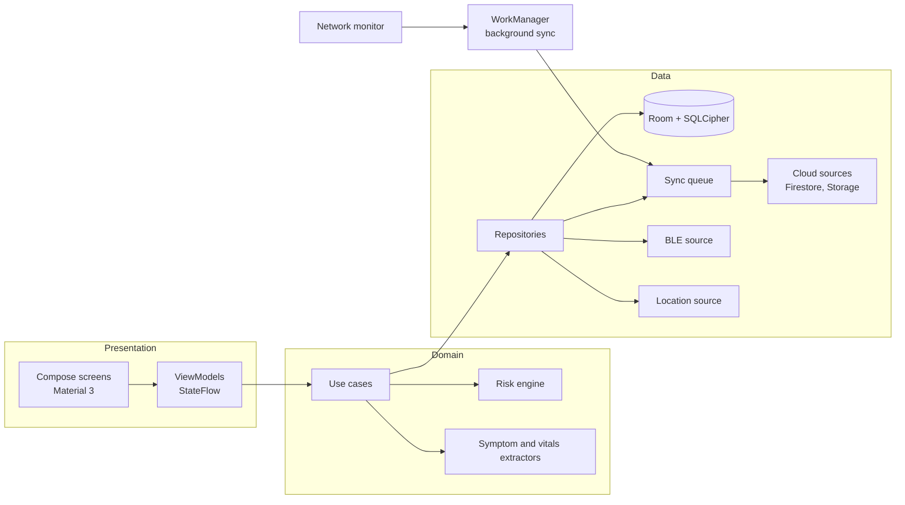

<div align="center">

# ASHASetu — आशा सेतू
### Offline-first voice triage and community care app for ASHA workers


[📥 Download APK](#-download-app-apk--installation-guide) · [📱 UI Screenshots & Walkthrough](#-ui-screenshots--screen-walkthrough) · [📖 Operating Instructions](#-step-by-step-field-operating-instructions) · [Features](#-features) · [Workflow](#-how-it-works) · [Triage](#-clinical-risk-engine) · [Architecture](#-architecture) · [Build](#-build--run)

</div>

> **Disclaimer:** ASHASetu is a clinical decision-support prototype built for Accredited Social Health Activists (ASHAs) under the National Health Mission (NHM). It provides clinical decision-support, not certified independent diagnosis. Final medical decisions rest with a qualified medical officer.

---

## 📥 Download App APK & Installation Guide

| Build Variant | Architecture | APK Download Link | Minimum OS |
| :--- | :--- | :--- | :--- |
| 🟢 **ASHASetu v1.0.0 (Debug APK)** | Universal (`arm64-v8a`, `armeabi-v7a`, `x86_64`) | [**Download ASHASetu APK**](https://github.com/Yokesveren/SevaSetu-Team_Byteclub/releases/latest/download/ashasetu-app-debug.apk) | Android 7.0+ (API 24+) |

### 📲 Step-by-Step Installation Instructions

1. **Download APK**: Tap the [Download ASHASetu APK](https://github.com/Yokesveren/SevaSetu-Team_Byteclub/releases/latest/download/ashasetu-app-debug.apk) link on your Android device.
2. **Enable Unknown Sources**:
   * Go to **Settings** ➔ **Security & Privacy** (or **Apps & Notifications**).
   * Enable **Install Unknown Apps** (or "Allow from this source") for your browser or file manager.
3. **Install Application**:
   * Open your device **Downloads** folder or **File Manager**.
   * Tap `ashasetu-app-debug.apk` and press **Install**.
4. **Grant Required Permissions**:
   * Open **ASHASetu (आशा सेतू)**.
   * Allow permissions when prompted:
     * 🎙️ **Microphone**: Required for Indic Voice Triage in Marathi, Hindi, Tamil & English.
     * 📍 **Location (GPS)**: Required for 108 Emergency SOS dispatch & PHC telemetry.
     * 📡 **Bluetooth / Wi-Fi**: Required for Wearable BLE oximeter & pulse pairing.

---

## 📱 UI Screenshots & Screen Walkthrough

Below is the complete UI layout showcase and screen-by-screen breakdown of **ASHASetu**:

### 1. 🔐 Authentication & Biometric Login (`LoginScreen.kt`)
```
┌──────────────────────────────────────────────┐
│  ASHA SETU (आशा सेतू)                         │
│  NHM Frontline Worker Portal                 │
│                                              │
│  [ ASHA Worker ID: ASHA-MH-7892            ] │
│  [ Password / PIN: ••••••                  ] │
│                                              │
│  ┌────────────────────────────────────────┐  │
│  │   🔓 LOG IN WITH ASHA CREDENTIALS      │  │
│  └────────────────────────────────────────┘  │
│                     OR                       │
│  ┌────────────────────────────────────────┐  │
│  │   👆 USE BIOMETRIC FINGERPRINT          │  │
│  └────────────────────────────────────────┘  │
└──────────────────────────────────────────────┘
```

### 2. 🏠 ASHA Home Dashboard (`DashboardScreen.kt`)
```
┌──────────────────────────────────────────────┐
│  👋 Namaste, Sunita Tai (Palghar Sub-Center) │
│  🟢 Sync Vault: 0 Pending | Cloud Connected  │
│ ──────────────────────────────────────────── │
│  QUICK ACTIONS:                              │
│  ┌──────────────────┐  ┌──────────────────┐  │
│  │ 🎙️ NEW VOICE     │  │ 🧑‍🤝‍🧑 PATIENT     │  │
│  │    TRIAGE        │  │    REGISTRY      │  │
│  └──────────────────┘  └──────────────────┘  │
│  ┌──────────────────┐  ┌──────────────────┐  │
│  │ 🏥 HOSPITAL      │  │ 🚨 108 SOS       │  │
│  │    REFERRAL      │  │    DISPATCH      │  │
│  └──────────────────┘  └──────────────────┘  │
│                                              │
│  HIGH-RISK ANC FOLLOW-UPS:                   │
│  • Sunita Devi (PAT-101) - 🔴 RED RISK       │
│  • Rekha Patil (PAT-104) - 🟡 YELLOW RISK    │
└──────────────────────────────────────────────┘
```

### 3. 🎙️ Indic AI Multilingual Voice Triage (`TriageCaptureScreen.kt`)
```
┌──────────────────────────────────────────────┐
│  INDIC VOICE TRIAGE (आशा सेतू)                │
│  Language: [ Marathi (मराठी)  ▼ ]            │
│                                              │
│  ┌────────────────────────────────────────┐  │
│  │  🎙️ TAP MIC TO SPEAK SYMPTOMS & VITALS │  │
│  └────────────────────────────────────────┘  │
│  Transcribed Voice Text:                     │
│  "माझ्या पोटात खूप दुखत आहे, BP 160 by 110" │
│                                              │
│  EXTRACTED CLINICAL DATA:                    │
│  • Symptoms: Severe Abdominal Pain, Headache │
│  • BP: 160 / 110 mmHg (Hypertensive)         │
│  • SpO2: 96%  | Pulse: 98 bpm                │
│                                              │
│  [ CALCULATE CLINICAL RISK & RUN ENGINE ]    │
└──────────────────────────────────────────────┘
```

### 4. 🔴 Triage Risk Assessment & Protocol (`TriageRecordDetailScreen.kt`)
```
┌──────────────────────────────────────────────┐
│  PATIENT: Sunita Devi (26y, ANC Trimester 2) │
│                                              │
│  ┌────────────────────────────────────────┐  │
│  │  🔴 RED EMERGENCY RISK | SCORE: 89/100 │  │
│  └────────────────────────────────────────┘  │
│  Clinical Reason: Severe Preeclampsia /      │
│  Critical Hypertension Protocol (BP 160/110) │
│                                              │
│  ACTION ADVICE:                              │
│  Immediate referral to District Hospital /   │
│  Sub-District Trauma Center.                 │
│                                              │
│  ┌────────────────────────────────────────┐  │
│  │ 👩‍⚕️ REQUEST PHC DOCTOR TELE-CONSULT      │  │
│  └────────────────────────────────────────┘  │
└──────────────────────────────────────────────┘
```

### 5. 💬 PHC Teleconsultation & Live Chat (`DoctorChatScreen.kt`)
```
┌──────────────────────────────────────────────┐
│  TELECONSULTATION - Dr. Aravind Kumar (PHC)  │
│  Status: 🟢 APPROVED & CONNECTED              │
│ ──────────────────────────────────────────── │
│  [Doctor]: Keep patient in left lateral tilt │
│  [ASHA]: Attached spot-bleeding image photo. │
│                                              │
│  [Doctor]: 108 Ambulance dispatched.         │
│ ──────────────────────────────────────────── │
│  [ 🎙️ Voice Message ] [ 📷 Attach Medical Photo ]
│  [ Send Message                               ]
└──────────────────────────────────────────────┘
```

### 6. 🚨 108 Emergency SOS Dispatch (`SosInboxScreen.kt`)
```
┌──────────────────────────────────────────────┐
│  🚨 108 EMERGENCY SOS DISPATCH               │
│  GPS Location: 19.6967 N, 72.7699 E          │
│                                              │
│  ┌────────────────────────────────────────┐  │
│  │  🔴 TAP TO BROADCAST 108 EMERGENCY SOS │  │
│  └────────────────────────────────────────┘  │
│  Alert Target: PHC Command & 108 Ambulance   │
│                                              │
│  STATUS: 🟢 Active Dispatch Broadcasted      │
│  108 Ambulance Unit #MH-15-4321 En Route     │
└──────────────────────────────────────────────┘
```

### 7. 🏥 Hospital Referral & Bed Pre-Booking (`ReferralScreen.kt`)
```
┌──────────────────────────────────────────────┐
│  NEARBY HEALTHCARE FACILITIES                │
│                                              │
│  1. Palghar District Hospital (12.4 km)      │
│     • ICU Beds Available: 4 / 20             │
│     • Oxygen: 🟢 Available | Blood Bank: 🟢   │
│     [ PRE-BOOK ICU BED & DISPATCH AMBULANCE ]│
│                                              │
│  2. Vikramgad CHC (6.1 km)                   │
│     • General Beds: 8 | Oxygen: 🟢           │
│     [ REFER PATIENT TO CHC ]                 │
└──────────────────────────────────────────────┘
```

### 8. 🧑‍🤝‍🧑 Patient Registry & ABHA Registration (`AddPatientScreen.kt`)
```
┌──────────────────────────────────────────────┐
│  REGISTER NEW PATIENT                        │
│  Full Name:   [ Sunita Devi                ] │
│  Age:         [ 26                         ] │
│  ABHA ID:     [ 14-3456-7890-1234          ] │
│  Cohort:      [ ANC (Maternal)           ▼ ] │
│  Trimester:   [ Trimester 2              ▼ ] │
│  Village:     [ Palghar                    ] │
│                                              │
│  [ SAVE PATIENT TO ENCRYPTED VAULT ]         │
└──────────────────────────────────────────────┘
```

### 9. ⌚ Wearable BLE Sensor Pairing (`WearablePairingScreen.kt`)
```
┌──────────────────────────────────────────────┐
│  WEARABLE BLE SENSOR PAIRING                 │
│  Status: 🟢 Connected to 'IOT_WEARABLE'      │
│                                              │
│  LIVE VITALS STREAM:                         │
│  • Heart Rate:  98 BPM                       │
│  • SpO2:        96%                          │
│  • Body Temp:   37.0 °C                      │
│                                              │
│  [ STREAM LIVE VITALS INTO TRIAGE FORM ]     │
└──────────────────────────────────────────────┘
```

### 10. 📅 Follow-Up & Community Task Manager (`FollowUpScreen.kt`)
```
┌──────────────────────────────────────────────┐
│  COMMUNITY CARE FOLLOW-UP TASKS              │
│                                              │
│  • Sunita Devi - High-Risk ANC Visit         │
│    Due: Today | Status: 🔴 Overdue           │
│    [ MARK AS COMPLETED ]                     │
│                                              │
│  • Rahul Kumar - Infant Vaccination (Polio)  │
│    Due: Tomorrow | Status: 🟢 Scheduled       │
│    [ MARK AS COMPLETED ]                     │
└──────────────────────────────────────────────┘
```

---

## 📖 Step-by-Step Field Operating Instructions

1. **Log in**: Authenticate via ASHA Worker ID or Biometric Fingerprint on `LoginScreen`.
2. **Select / Onboard Patient**: Open `Patient Registry`, enter ABHA ID (`14-3456-7890-1234`), and select cohort (`ANC`, `TB`, `CHILD`).
3. **Voice Triage**: Tap **New Voice Triage**, choose language (Marathi/Hindi/Tamil/English), tap microphone, and speak symptoms/vitals.
4. **Evaluate Risk**: Review the Red/Yellow/Green priority score (1-100) and clinical protocol.
5. **Teleconsult Doctor**: Tap **Request PHC Doctor Teleconsult** to route encounter to `Dr. Aravind Kumar`. Send voice messages and medical photos in live chat.
6. **Emergency Dispatch**: Tap **108 SOS Dispatch** to capture GPS location and broadcast emergency alerts to 108 Ambulance Command.
7. **Offline Vault & Background Sync**: All encounters are saved to local encrypted vault (SQLCipher 256-bit AES) and flushed to Cloud Firestore automatically by WorkManager when 4G/3G connectivity is restored.

---

## 🎯 Why ASHASetu

ASHA workers are the first point of care for millions of people, yet they often work in villages with weak or no connectivity, with paper registers, in several languages, and with no immediate access to a doctor. A late referral for a high-risk pregnancy can cost a life.

**ASHASetu puts a triage-grade clinic in the ASHA worker's phone**: speak symptoms in your own language, capture vitals, get an explainable Green / Yellow / Red risk band in seconds, and reach a PHC doctor or an ambulance, even if the network is down when you start.

| Challenge in the field | How ASHASetu responds |
| :--- | :--- |
| No or flaky signal | Everything works offline. Data is stored in an encrypted vault and synced automatically later. |
| Language barriers and typing burden | Voice input in Marathi, Hindi, Tamil and English with automatic symptom and vitals extraction. |
| Uncertainty about severity | Deterministic, explainable risk engine returns a band, a priority score and a clear reason. |
| Delay in reaching a doctor | One-tap teleconsultation with live chat and photo sharing. |
| Emergencies | One-tap SOS with GPS broadcast and 108 ambulance request. |
| Unknown hospital capacity | Referral screen shows nearby facilities with ICU, oxygen and blood-bank status and how recent that data is. |
| Missed follow-ups | Task list for ANC, immunisation, TB DOTS and hypertension, with overdue highlighting. |

---

## ✨ Features

### 🎙️ 1. Multilingual voice triage
- Voice input in **Marathi (`mr-IN`)**, **Hindi (`hi-IN`)**, **Tamil (`ta-IN`)** and **Kannada (`ka-IN`)**  using Android's native speech recognizer.
- **Symptom extractor** matches clinical terms across all four languages (for example severe headache, vaginal bleeding, chest pain, high fever, reduced fetal movement, convulsions).
- **Vitals extractor** turns spoken numbers into structured vitals such as blood pressure, pulse, SpO₂ and haemoglobin ("BP 160 by 110", "SpO2 94 percent").

### 🧮 2. Clinical risk engine
- Deterministic scoring from **1 to 100** with an explicit clinical reason.
- Produces step-by-step action advice, the required **specialty** (Obstetrics, Cardiology, Neurology, Paediatrics, Trauma) and the recommended **facility tier** (PHC, CHC, Sub-District Hospital, District Hospital).

### 🧑‍🤝‍🧑 3. Patient registry and ABHA
- Registration with **ABHA ID**, ANC trimester, cohort (`ANC`, `TB`, `CHRONIC`, `CHILD`, `GENERAL`), village and responsible ASHA.
- **Incident and unattended-visit logging**, so field mishaps or missed visits reach the PHC.
- **Triage history** per patient with risk badges. Tapping an entry opens the full encounter.

### 👩‍⚕️ 4. PHC teleconsultation
- Sends the full triage packet to the PHC doctor queue as a teleconsult request.
- Shows a connection-pending screen until the doctor accepts.
- **Live two-way chat** with voice-to-text composition and **medical photo attachment**.
- Doctor acknowledgement and admin approval status update live on the case card.

### 🚨 5. One-tap SOS
- Captures device GPS and broadcasts an emergency alert with maternal risk details to the PHC console and the 108 command flow.

### 🏥 6. Referral and bed pre-booking
- Lists nearby District Hospitals, CHCs and PHCs with **ICU beds, oxygen, blood bank, distance and data staleness**.
- Pre-books a bed and raises a **108 ambulance request**. Live ambulance status returns to the app as a pop-up and status card.

### 📅 7. Follow-up and task management
- Scheduled tasks for high-risk ANC visits, infant vaccination, TB DOTS adherence and hypertension monitoring, with overdue highlighting.

### ⌚ 8. Wearable and sensor integration
- **Bluetooth Low Energy** pairing with pulse oximeters and heart-rate monitors, streaming vitals straight into the triage form.

### 🔐 9. Offline vault and background sync
- Room database encrypted with **SQLCipher AES-256**.
- Every change is queued and flushed to the cloud by **WorkManager** when connectivity returns, in priority order.

### 📍 10. Frontline worker telemetry
- Periodically reports worker location, battery level, network type and pending-sync count so the PHC can see field coverage and sync health. Intended for use with the worker's informed consent.

---

## 🩺 Clinical Risk Engine

| Band | Priority score | Example triggers | Suggested action |
| :--- | :---: | :--- | :--- |
| 🔴 **RED** (Emergency) | **85–100** | Severe pre-eclampsia, postpartum haemorrhage, SpO₂ below 90%, fetal heart rate below 110 or above 160, BP at or above 160/110 | Immediate referral to a District Hospital or trauma centre, dispatch 108 |
| 🟡 **YELLOW** (Urgent) | **50–84** | Moderate anaemia (Hb 7.0–9.9 g/dL), BP 140–159 / 90–109, moderate fever | Same-day teleconsultation |
| 🟢 **GREEN** (Routine) | **10–49** | Routine ANC / PNC, stable vitals | Home care and scheduled follow-up |

---

## 🏗️ Architecture

Clean Architecture with MVVM and unidirectional state flow.



---

## 🛡️ Security & Privacy

| Area | Implementation |
| :--- | :--- |
| Data at rest | SQLCipher AES-256 encrypted Room database + Android KeyStore 256-bit key management |
| Data in transit | TLS via Firebase SDKs |
| Cleartext Traffic | Scoped Network Security Config restricting cleartext HTTP to local ESP32 IoT domain (`192.168.4.1`) |
| Backup Protection | `android:allowBackup="false"` to prevent unauthorized ADB data extraction |
| Secrets | No credentials, keys or patient data committed |

---

## 🚀 Build & Run

```bash
# 1. Clone repo
git clone https://github.com/Yokesveren/SevaSetu-Team_Byteclub.git
cd SevaSetu-Team_Byteclub/Ashasetu-Androidapp

# 2. Build debug APK
./gradlew :androidApp:assembleDebug

# 3. Deploy APK to device
adb install -r androidApp/build/outputs/apk/debug/androidApp-debug.apk
```

---

## 👥 Team

Built by **Team Byteclub / Team Cantina**
