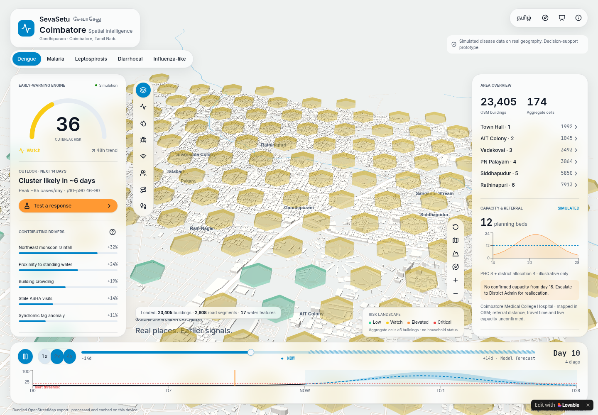
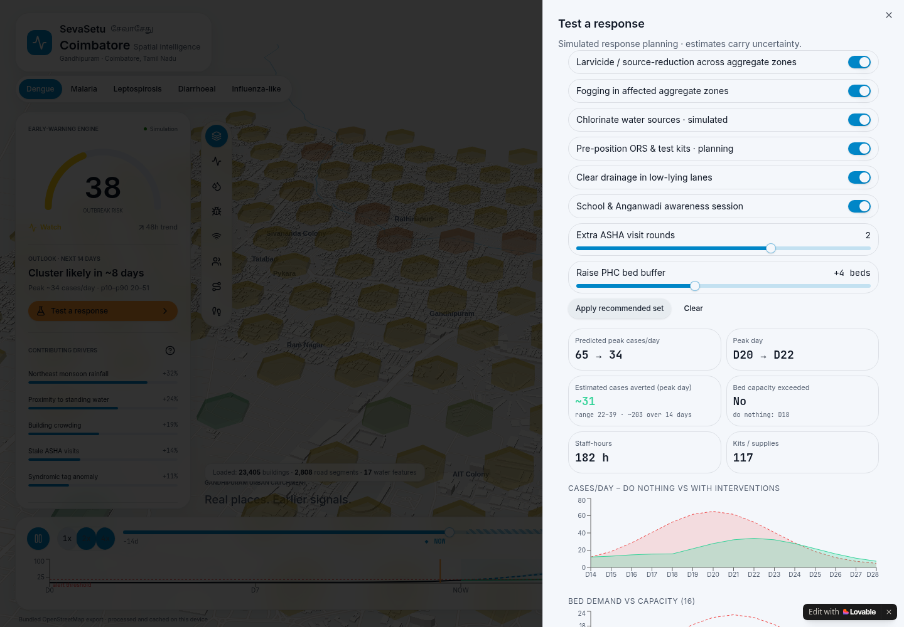
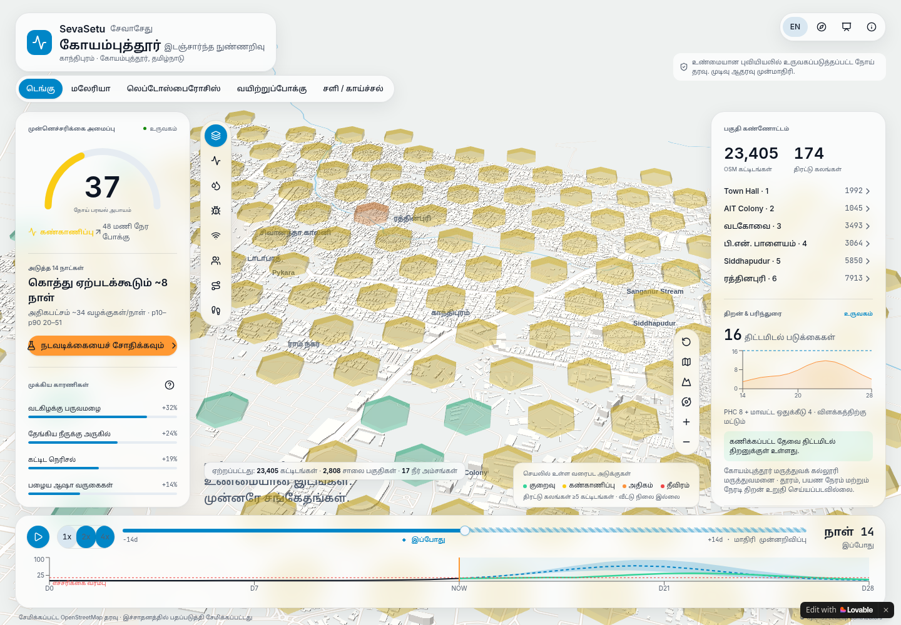
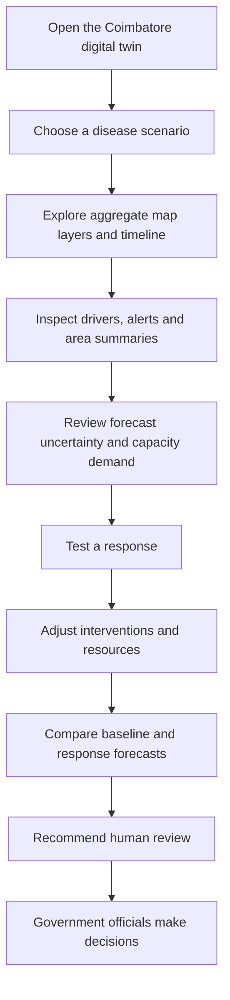
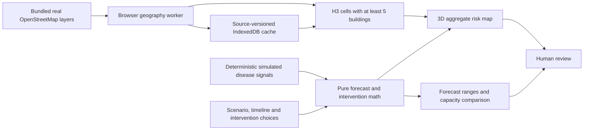

# SevaSetu Predictive Dashboard

[**Open the live dashboard ↗**](https://seva-village-health-twin.lovable.app/digital-twin) · [Screenshots](#website-gallery) · [Workflow](#how-the-dashboard-works) · [Run locally](#run-locally) · [Data & privacy](#geography-and-data)

A public-health decision-support prototype for **Gandhipuram and central Coimbatore, Tamil Nadu**. It combines real OpenStreetMap geography with deterministic, simulated disease signals to explore potential outbreaks and compare response plans.

> **Simulated disease data on real geography. Decision-support prototype.** This is not a clinical system, a trained outbreak model, or a source of confirmed patient, population, facility-capacity or referral information.

## Live deployment

**Website:** [seva-village-health-twin.lovable.app](https://seva-village-health-twin.lovable.app)  
**Dashboard:** [Open `/digital-twin`](https://seva-village-health-twin.lovable.app/digital-twin)

The public deployment is accessible without a Lovable account. The screenshots below were captured from this live website.

## Website gallery

### Real Coimbatore geography, simulated early warnings

[](https://seva-village-health-twin.lovable.app/digital-twin)

*Click the image to explore the live dashboard. The map shows real OpenStreetMap footprints; risk colours belong to aggregate cells, not individual buildings.*

<details>
<summary><strong>View the response-planning comparison</strong></summary>



In the illustrated dengue scenario, the recommended set changes the **simulated peak from 65 to 34 cases/day** and shifts the peak from **day 20 to day 22**. These are prototype estimates, not validated treatment or outbreak outcomes.

</details>

<details>
<summary><strong>View the Tamil dashboard</strong></summary>



The language toggle switches the dashboard between English and Tamil.

</details>

## How the dashboard works

### Explore → understand → compare → recommend review



### Real geography + simulated signals



<details>
<summary><strong>Try the core demo workflow</strong></summary>

1. Open the live dashboard and select **Dengue**.
2. Move the timeline from historical signals into the forecast period.
3. Inspect a contributing driver or an aggregate zone.
4. Select **Test a response**, then **Apply recommended set**.
5. Compare the projected peak, uncertainty range and bed-demand charts.
6. Switch to Tamil or another disease scenario to explore the same planning workflow.

All displayed health outcomes remain simulated; recommendations require human review.

</details>

## Dashboard capabilities

- Interactive 3D map with real building footprints, roads, waterways, land use and named places from a bundled OpenStreetMap export.
- Privacy-safe H3 hexagonal risk summaries and 3D risk columns; health data is displayed only for aggregates containing at least five buildings, never for individual buildings or residents.
- Dengue, malaria, leptospirosis, diarrhoeal disease and influenza-like illness scenarios.
- Historical and forecast timeline, playback controls, case projections and confidence ranges.
- Explainable risk drivers, area details, alerts and recommendations for human review.
- Response-planning simulator comparing baseline and intervention forecasts, peak cases, estimated impact and capacity demand.
- English and Tamil interface, with layouts for desktop, tablet and phone.
- Loading, error and retry states, plus source-versioned IndexedDB caching of processed geography.

Only government officials make containment decisions; this dashboard recommends review rather than declaring containment zones. Facility locations are taken from the mapped source, not invented; service and capacity details remain unverified.

## Geography and data

The bundled central-Coimbatore extract includes **23,405 buildings, 2,808 road segments and 17 water features**, with additional land-use, point-of-interest and place-name layers. Data bounds are approximately longitude 76.945–76.985 and latitude 10.995–11.035. The initial view is centred near Gandhipuram (11.0182714, 76.9677744).

The application loads the files in `public/data/coimbatore/`. It does **not** query Overpass or OpenStreetMap at runtime. Building heights use `building:levels × 3.2 m`, then a height tag, otherwise a deterministic 4–8 m estimate. Heights and simulated health signals are not survey measurements.

**© OpenStreetMap contributors.** OpenStreetMap data is available under the [Open Database License](https://www.openstreetmap.org/copyright). Export details are recorded in `public/data/coimbatore/provenance.json`.

All disease signals and forecasts are seeded simulations. No real patient records, authentication or application database are required.

## Run locally

Prerequisites: a current Node.js release and [Bun](https://bun.sh/).

```sh
cd Predictive_dashboard
bun install
bun run dev
```

Open the address printed by Vite and visit `/digital-twin`. The root page also opens the Coimbatore dashboard.

```sh
bun run test     # Geography, privacy, routing and simulation tests
bun run build    # Production build
bun run preview  # Preview the production build
```

The project uses TanStack Start with a Cloudflare-oriented build configuration. Deployment requires a compatible host and that host's normal configuration; no disease-data service or private API key is needed for the demo.

## Technology and structure

React 19, TypeScript, TanStack Start/Router, Vite, Tailwind CSS, shadcn/ui, Zustand, MapLibre GL, deck.gl, H3, Recharts and Framer Motion.

```text
src/components/twin/       Dashboard, map and response-planning interface
src/routes/               Root and /digital-twin pages
src/data/                 Deterministic simulated signals and story data
src/lib/sim.ts            Pure forecast and intervention calculations
src/lib/geo.ts            Geography processing and aggregate summaries
src/lib/load-geography.ts Bundled geography loader
src/lib/geography-cache.ts IndexedDB cache
src/store/twinStore.ts    Shared dashboard state
src/workers/              Browser-worker geography preprocessing
src/test/                 Automated tests
public/data/coimbatore/   Real bundled OpenStreetMap layers and provenance
```

Map rendering is dynamically loaded in the browser, and geography preprocessing runs in a worker. Simulation state has one shared source of truth; intervention calculations remain pure and deterministic.

## Limitations

This prototype illustrates planning workflows, not validated epidemiological predictions. Case counts, intervention effects and capacity estimates are simulated. Actual deployment for health decisions would require validated models, verified local data, governance and clinical/public-health review. The export contains source, configuration, tests and bundled geography; installed dependencies, secrets, repository metadata and generated build output are intentionally excluded.
