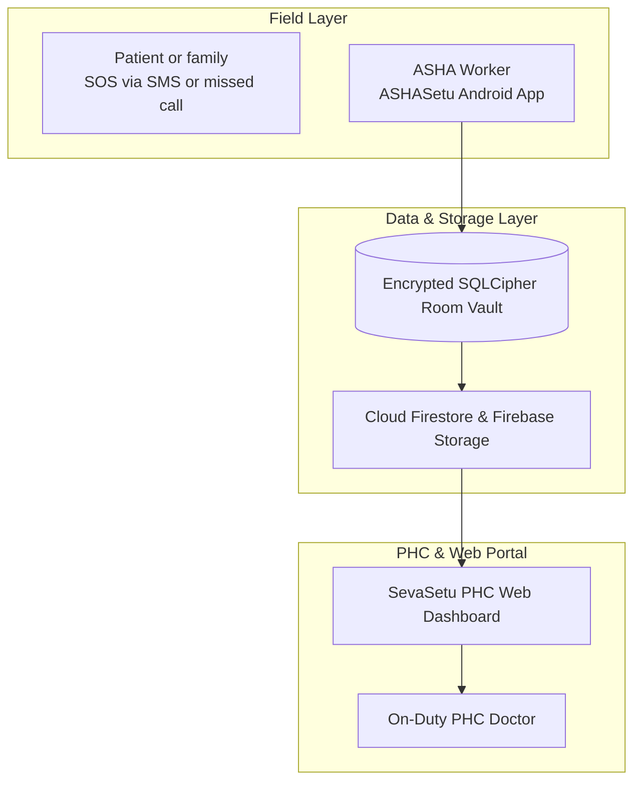

<div align="center">

# SevaSetu — सेवासेतु
### The offline-first data layer that connects ASHA workers, PHCs and district hospitals in hilly taluks of india.


[🚀 Live Demo](#-live-demo--videos) · [📥 Download Android App](#-download-ashasetu-android-app-apk) · [📱 UI Screenshots](#-ashasetu-android-app-ui-screenshots--walkthrough) · [📖 Operating Instructions](#-step-by-step-field-operating-instructions) · [The Problem](#-the-problem) · [Our Solution](#-our-solution) · [Architecture](#-system-architecture)

</div>

> **Disclaimer:** SevaSetu is an independent hackathon prototype. It is not an official Government of India product and is not affiliated with MoHFW, NHM, NHA or any state health department. It is clinical **decision-support** software, not a certified medical device.

---

## 🚀 Live Demo & Videos

| Resource | Link |
| :--- | :--- |
| 🌐 **Deployed PHC Web Portal** | [**Open the live web app →**](https://sevasethu-web.vercel.app/) |
| 📱 **ASHASetu Android App Repo** | [**View Ashasetu-Androidapp directory →**](https://github.com/Yokesveren/SevaSetu-Team_Byteclub/tree/main/Ashasetu-Androidapp) |
| 🎬 **Video 1: Project Walkthrough / Demo** | [**Watch on YouTube →**](https://www.youtube.com/watch?v=ap-gmuTtrpQ) |
| 🎬 **Video 2: Animated demo** | [**Watch on YouTube →**](https://www.youtube.com/watch?v=CpFEbZ00S2Y) |

---

## 📥 Download ASHASetu Android App APK

| Application Build | Target Architecture | APK Direct Download | Minimum OS Version |
| :--- | :--- | :--- | :--- |
| 🟢 **ASHASetu Android App (v1.0.0 Debug)** | Universal (`arm64-v8a`, `armeabi-v7a`, `x86_64`) | [**Download ASHASetu APK**](https://github.com/Yokesveren/SevaSetu-Team_Byteclub/releases/latest/download/ashasetu-app-debug.apk) | Android 7.0+ (API 24+) |

### 📲 How to Download & Install the Android App

1. **Download APK**: Tap [Download ASHASetu APK](https://github.com/Yokesveren/SevaSetu-Team_Byteclub/releases/latest/download/ashasetu-app-debug.apk) on your Android device.
2. **Enable Unknown Sources**:
   * Open Android **Settings** ➔ **Security** (or **Apps**).
   * Enable **Install Unknown Apps** (or "Allow from this source") for your Web Browser or File Manager.
3. **Install APK**:
   * Open device **Downloads** folder or **File Manager**.
   * Tap `ashasetu-app-debug.apk` and select **Install**.
4. **Grant Runtime Permissions**:
   * Open **ASHASetu (आशा सेतू)**.
   * Allow Microphone (Voice Triage), Location (108 SOS & Telemetry), and Bluetooth (Wearables) permissions.

---

## 📱 ASHASetu Android App UI Screenshots & Walkthrough

Below is a complete screen-by-screen breakdown of the **ASHASetu** Android application:

### 1. 🔐 Biometric & PIN Login Screen (`LoginScreen.kt`)
```
┌──────────────────────────────────────────────┐
│  ASHA SETU (आशा सेतू)                         │
│  NHM Frontline Worker Portal                 │
│                                              │
│  [ ASHA Worker ID: ASHA-MH-7892            ] │
│  [ Password / PIN: ••••••                  ] │
│                                              │
│  ┌────────────────────────────────────────┐  │
│  │   🔓 LOG IN WITH ASHA CREDENTIALS      │  │
│  └────────────────────────────────────────┘  │
│                     OR                       │
│  ┌────────────────────────────────────────┐  │
│  │   👆 USE BIOMETRIC FINGERPRINT          │  │
│  └────────────────────────────────────────┘  │
└──────────────────────────────────────────────┘
```

### 2. 🏠 ASHA Home Dashboard Screen (`DashboardScreen.kt`)
```
┌──────────────────────────────────────────────┐
│  👋 Namaste, Sunita Tai (Palghar Sub-Center) │
│  🟢 Sync Vault: 0 Pending | Cloud Connected  │
│ ──────────────────────────────────────────── │
│  QUICK ACTIONS:                              │
│  ┌──────────────────┐  ┌──────────────────┐  │
│  │ 🎙️ NEW VOICE     │  │ 🧑‍🤝‍🧑 PATIENT     │  │
│  │    TRIAGE        │  │    REGISTRY      │  │
│  └──────────────────┘  └──────────────────┘  │
│  ┌──────────────────┐  ┌──────────────────┐  │
│  │ 🏥 HOSPITAL      │  │ 🚨 108 SOS       │  │
│  │    REFERRAL      │  │    DISPATCH      │  │
│  └──────────────────┘  └──────────────────┘  │
│                                              │
│  HIGH-RISK ANC FOLLOW-UPS:                   │
│  • Sunita Devi (PAT-101) - 🔴 RED RISK       │
│  • Rekha Patil (PAT-104) - 🟡 YELLOW RISK    │
└──────────────────────────────────────────────┘
```

### 3. 🎙️ Indic AI Multilingual Voice Triage Screen (`TriageCaptureScreen.kt`)
```
┌──────────────────────────────────────────────┐
│  INDIC VOICE TRIAGE (आशा सेतू)                │
│  Language: [ Marathi (मराठी)  ▼ ]            │
│                                              │
│  ┌────────────────────────────────────────┐  │
│  │  🎙️ TAP MIC TO SPEAK SYMPTOMS & VITALS │  │
│  └────────────────────────────────────────┘  │
│  Transcribed Voice Text:                     │
│  "माझ्या पोटात खूप दुखत आहे, BP 160 by 110" │
│                                              │
│  EXTRACTED CLINICAL DATA:                    │
│  • Symptoms: Severe Abdominal Pain, Headache │
│  • BP: 160 / 110 mmHg (Hypertensive)         │
│  • SpO2: 96%  | Pulse: 98 bpm                │
│                                              │
│  [ CALCULATE CLINICAL RISK & RUN ENGINE ]    │
└──────────────────────────────────────────────┘
```

### 4. 🔴 Clinical Risk Assessment & Protocol Screen (`TriageRecordDetailScreen.kt`)
```
┌──────────────────────────────────────────────┐
│  PATIENT: Sunita Devi (26y, ANC Trimester 2) │
│                                              │
│  ┌────────────────────────────────────────┐  │
│  │  🔴 RED EMERGENCY RISK | SCORE: 89/100 │  │
│  └────────────────────────────────────────┘  │
│  Clinical Reason: Severe Preeclampsia /      │
│  Critical Hypertension Protocol (BP 160/110) │
│                                              │
│  ACTION ADVICE:                              │
│  Immediate referral to District Hospital /   │
│  Sub-District Trauma Center.                 │
│                                              │
│  ┌────────────────────────────────────────┐  │
│  │ 👩‍⚕️ REQUEST PHC DOCTOR TELE-CONSULT      │  │
│  └────────────────────────────────────────┘  │
└──────────────────────────────────────────────┘
```

### 5. 💬 PHC Teleconsultation & Live Chat Screen (`DoctorChatScreen.kt`)
```
┌──────────────────────────────────────────────┐
│  TELECONSULTATION - Dr. Aravind Kumar (PHC)  │
│  Status: 🟢 APPROVED & CONNECTED              │
│ ──────────────────────────────────────────── │
│  [Doctor]: Keep patient in left lateral tilt │
│  [ASHA]: Attached spot-bleeding image photo. │
│                                              │
│  [Doctor]: 108 Ambulance dispatched.         │
│ ──────────────────────────────────────────── │
│  [ 🎙️ Voice Message ] [ 📷 Attach Medical Photo ]
│  [ Send Message                               ]
└──────────────────────────────────────────────┘
```

### 6. 🚨 108 Emergency SOS Dispatch Screen (`SosInboxScreen.kt`)
```
┌──────────────────────────────────────────────┐
│  🚨 108 EMERGENCY SOS DISPATCH               │
│  GPS Location: 19.6967 N, 72.7699 E          │
│                                              │
│  ┌────────────────────────────────────────┐  │
│  │  🔴 TAP TO BROADCAST 108 EMERGENCY SOS │  │
│  └────────────────────────────────────────┘  │
│  Alert Target: PHC Command & 108 Ambulance   │
│                                              │
│  STATUS: 🟢 Active Dispatch Broadcasted      │
│  108 Ambulance Unit #MH-15-4321 En Route     │
└──────────────────────────────────────────────┘
```

### 7. 🏥 Hospital Facility Bed Pre-Booking Screen (`ReferralScreen.kt`)
```
┌──────────────────────────────────────────────┐
│  NEARBY HEALTHCARE FACILITIES                │
│                                              │
│  1. Palghar District Hospital (12.4 km)      │
│     • ICU Beds Available: 4 / 20             │
│     • Oxygen: 🟢 Available | Blood Bank: 🟢   │
│     [ PRE-BOOK ICU BED & DISPATCH AMBULANCE ]│
│                                              │
│  2. Vikramgad CHC (6.1 km)                   │
│     • General Beds: 8 | Oxygen: 🟢           │
│     [ REFER PATIENT TO CHC ]                 │
└──────────────────────────────────────────────┘
```

---

## 📖 Step-by-Step Field Operating Instructions

1. **Log in**: Authenticate via ASHA Worker ID or Biometric Fingerprint on `LoginScreen`.
2. **Select / Onboard Patient**: Open `Patient Registry`, enter ABHA ID (`14-3456-7890-1234`), and select cohort (`ANC`, `TB`, `CHILD`).
3. **Voice Triage**: Tap **New Voice Triage**, choose language (Marathi/Hindi/Tamil/English), tap microphone, and speak symptoms/vitals.
4. **Evaluate Risk**: Review the Red/Yellow/Green priority score (1-100) and clinical protocol.
5. **Teleconsult Doctor**: Tap **Request PHC Doctor Teleconsult** to route encounter to `Dr. Aravind Kumar`. Send voice messages and medical photos in live chat.
6. **Emergency Dispatch**: Tap **108 SOS Dispatch** to capture GPS location and broadcast emergency alerts to 108 Ambulance Command.
7. **Offline Vault & Background Sync**: All encounters are saved to local encrypted vault (SQLCipher 256-bit AES) and flushed to Cloud Firestore automatically by WorkManager when 4G/3G connectivity is restored.

---

## 🧭 The Problem

India's public health system already has the people and the infrastructure: ASHA workers, sub-centres, PHCs, district hospitals, 108/112 emergency dispatch and the IHIP disease-surveillance platform. What breaks down in rural and underserved areas is the **data layer between them**:

- Connectivity drops exactly where care is needed most, so digital tools quietly stop working in the field.
- Patient records are fragmented, so continuity of care is lost between visits and facilities.
- Referrals are made by distance alone, without knowing whether the destination has the specialty, bed or stock.
- Emergency hand-offs happen as verbal phone descriptions, which are slow and lossy.
- Disease-surveillance depends on separate manual reporting forms on top of an already heavy ASHA workload.

## 💡 Our Solution

**SevaSetu ("Service Bridge") captures triage-grade patient data even with zero signal, encodes it into standard clinical codes, routes each case to where care capacity actually exists, and turns the same data into an early-warning signal for the district. It does all of this without duplicating any national system already doing part of the job.**

| Pillar | What it does |
| :--- | :--- |
| 📴 **Offline-first capture** | ASHA workers triage fully offline: voice symptoms in regional languages, vitals from a BLE sensor kit, on-device risk classification. |
| 📡 **Dead-zone bridge** | A LoRa radio link relays Yellow and Red case summaries to the nearest PHC when there is no cellular signal at all. |
| 🧠 **Explainable triage** | Hybrid rule and ML engine. Every Green / Yellow / Red result comes with a plain-language clinical reason, never a bare number. |
| 🏥 **Capacity-aware referral** | Facilities are ranked by specialty match, live capacity, stock and travel time, not distance alone. |
| 🚑 **Emergency hand-off** | Red cases generate a structured, pre-triaged case packet for 108/112 instead of a verbal description. |
| 🦠 **Free outbreak signal** | Each encounter emits an anonymous syndromic tag that feeds a district heatmap and an IHIP-compatible export. |
| 🔁 **Continuity of care** | ABHA-anchored longitudinal records, aftercare schedules and defaulter alerts. |

---

## 🧩 Platform Components

| Component | Audience | Surface | Repository Location |
| :--- | :--- | :--- | :--- |
| **ASHASetu** | ASHA / ANM workers | Android app, offline-first | [`Ashasetu-Androidapp/`](./Ashasetu-Androidapp) |
| **SevaSetu PHC Portal** | PHC doctors, facility staff, PHC admins | React web dashboard | [`SevaSethu(Web)/`](./SevaSethu(Web)) |

---

## 🏗️ System Architecture



---

## 👥 Team

Built by **Team Byteclub / Team Cantina**
